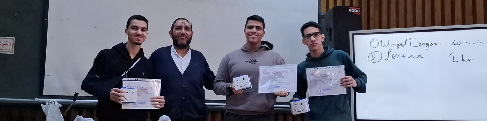

# 💫 About Me:
AI Engineering student & Freelance Data Scientist based in Egypt. I build machine learning pipelines, design complex databases, and write cross-platform desktop applications in C++ and Java. Powered by Neovim and Linux.

## 🌐 Socials:
    

# 💻 Tech Stack:
                   
# 📊 GitHub Stats:

 

<!-- Proudly created with GPRM ( https://gprm.itsvg.in ) -->

<picture>
  <source media="(prefers-color-scheme: dark)" srcset="https://raw.githubusercontent.com/3mortal-dev/3mortal-dev/output/github-snake-dark.svg" />
  <source media="(prefers-color-scheme: light)" srcset="https://raw.githubusercontent.com/3mortal-dev/3mortal-dev/output/github-snake.svg" />
  
</picture>
